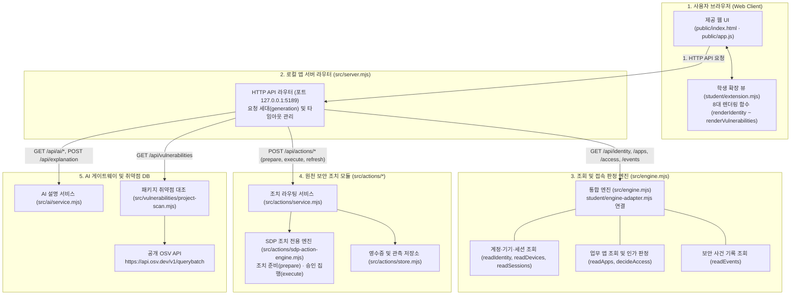

# 보안 Agent 「케셰브」 학생 실행 설명서 및 시스템 구성도 (STUDENT_RUNBOOK)

이 문서는 보안 Agent **「케셰브」** 프로젝트의 구조, 실행 방법, 시스템 구성도, 제공/학생 경계 및 장애 해결 절차를 기술한 공식 학생 실행 설명서(Runbook)입니다. 다른 작업자가 새로운 환경의 Windows PowerShell에서 이 설명서만 보고 프로젝트를 실행하고 검증할 수 있도록 실제 코드와 설정에 부합하는 명령어와 파일 경로만을 작성했습니다.

---

## 1. 실행 환경 및 사전 준비

### 1) 지원 런타임 및 확인된 버전 (`support_scope_honest`)
* **운영체제**: Microsoft Windows (Windows 10 / 11 64-bit)
* **명령 셸**: Windows PowerShell (또는 PowerShell 7)
* **공식 선언 버전**: **Node.js `24.19.0`** (`package.json`의 `engines`에 선언된 검증 기준 버전)
* **실행 지원 범위**: **Node.js `22 ~ 24`** (원문 전달 도구 및 런처가 요구·지원하는 검증 범위)
  * 버전 확인 명령: `node -v`
  * *주의: Node.js 20, 21 및 그 이하 버전은 호환성이 검증되지 않았으며 공식 지원 범위에 포함되지 않습니다.*
* **외부 의존성**: **없음**
  * `package.json`에 `private: true`로 선언되어 있으며 외부 npm 패키지를 설치하지 않습니다 (`npm install` 불필요). Node.js 내장 모듈만을 사용하여 구동됩니다.

### 2) Windows PowerShell 보안 정책 주의사항
* Windows의 기본 스크립트 실행 정책(`ExecutionPolicy`) 제한으로 인해 `npm` 입력 시 `npm.ps1 파일을 로드할 수 없습니다(PSSecurityException)` 오류가 발생할 수 있습니다.
* 따라서 PowerShell에서는 **`npm.cmd`** 배치 파일을 명시하거나, `node src/server.mjs` 명령어로 직접 실행하는 것을 표준 절차로 삼습니다.

---

## 2. 저장소 및 작업 폴더 구조

프로젝트 실행 작업은 작성자 개인 PC의 특정 절대 경로에 종속되지 않으며, **저장소의 `on-client` 폴더**에서 수행됩니다.

* **프로젝트 저장소 최상위 (Git Root)**: Git 저장소를 복제한 폴더 (`.git`이 존재하는 루트)
* **실행 작업 폴더 (on-client)**: 프로젝트 최상위 바로 아래에 위치한 `on-client` 폴더

### 폴더 구조 및 제공/학생 경계 (`provided_student_boundary`)
`.on-starter-manifest.json`의 원천 해시를 기준으로 구분됩니다:

```text
<프로젝트_저장소_최상위>/
├── .git/                                   # Git 저장소 메타데이터
└── on-client/                              # 실제 클라이언트 프로젝트 루트 (실행 작업 위치)
    ├── package.json                        # 실행 스크립트 (engines: 24.19.0)
    ├── .env.example                        # 환경 변수 견본 (비밀값 없음)
    ├── .on-starter-manifest.json           # 제공 코드 원천 해시 목록 (무결성 기준)
    │
    ├── student/                            # 학생 폴더
    │   ├── extension.mjs                   # ★ [유일한 학생 작성 파일] 13~20단계 UI 렌더링 8대 함수 구현
    │   └── engine-adapter.mjs              # [제공 파일] manifest에 해시가 등록된 제공 엔진 어댑터 틀
    │
    ├── src/                                # [제공 영역] 로컬 백엔드 서버
    │   ├── server.mjs                      # HTTP 웹 서버 진입점 (포트 5189)
    │   ├── engine.mjs                      # 계정·기기·앱 접속 판정·사건 조회 엔진
    │   ├── actions/                        # 원천 보안 조치(Action: prepare/execute) 전용 서비스
    │   │   ├── sdp-action-engine.mjs       # SDP 호스트의 조치 전용 메서드 연결
    │   │   ├── service.mjs                 # 조치 수명주기 라우팅
    │   │   └── store.mjs                   # 조치 상태 및 영수증 저장소
    │   ├── ai/                             # 수업용 AI 게이트웨이 연동 서비스
    │   ├── connection/                     # 계정/기기 연결 관리자
    │   └── vulnerabilities/                # OSV 패키지 취약점 대조 서비스 (project-scan.mjs, osv.mjs)
    │
    ├── public/                             # [제공 영역] 브라우저 웹 클라이언트 정적 자원
    │   ├── index.html                      # 메인 화면 구조
    │   ├── app.js                          # UI 상태 관리 및 student/extension.mjs 렌더링 호출
    │   ├── style.css                       # 공통 스타일시트
    │   └── vulnerabilities-view.mjs        # 제공 패키지 조회 UI 모듈
    │
    ├── docs/                               # 문서 폴더
    │   ├── STUDENT_RUNBOOK.md              # [본 문서] 학생 실행 설명서
    │   └── summary_md/                     # 단계별 요약 백업
    ├── summary_md/                         # 단계별 작업 요약 문서
    └── tools/                              # 실행 보조 스크립트 (start-alekov.ps1 등)
```

---

## 3. 설치 및 실행 절차 (`run_instructions_match_source`)

어떤 환경에서도 아래 순서대로 실행할 수 있습니다.

### 1단계: 실행 작업 폴더(`on-client`)로 이동
Git 최상위 폴더에서 터미널을 열고 하위의 `on-client` 폴더로 이동합니다.
```powershell
# Git 최상위 폴더 기준:
cd on-client
```
*(만약 다른 위치에 있다면 본인의 프로젝트 저장소 경로 아래 `on-client` 폴더로 이동하세요. 예: `cd <본인저장소경로>\on-client`)*

### 2단계: Node.js 버전 및 학생 구현 구문 검사
지원 버전(Node.js 22~24, 기준 24.19.0) 및 학생 코드의 구문 무결성을 확인합니다.
```powershell
# Node 버전 확인 (v22.x ~ v24.x 확인)
node -v

# 학생 구현 코드 구문 검사
node --check student/extension.mjs
```
*(오류 없이 다음 줄 프롬프트가 나오면 정상입니다.)*

### 3단계: 로컬 서버 실행
원하는 모드에 맞춰 명령어를 실행합니다:

* **방법 A. 데모 모드로 실행 (화면 및 기능 검증 권장)**:
  예제 자료(모의 데이터)가 로드되어 브라우저에서 모든 화면 기능을 즉시 테스트할 수 있습니다.
  ```powershell
  npm.cmd run demo
  ```
  *(또는 `node src/server.mjs --demo`)*

* **방법 B. 기본 모드로 실행**:
  ```powershell
  npm.cmd start
  ```
  *(또는 `node src/server.mjs`)*

### 4단계: 정상 시작 신호 확인 및 브라우저 접속
* **정상 시작 신호**:
  서버가 구동되면 콘솔에 접속 주소가 출력됩니다:
  ```text
  http://127.0.0.1:5189
  ```
* **브라우저 접속**:
  웹 브라우저를 열고 아래 로컬 주소로 접속합니다:
  👉 **http://127.0.0.1:5189**

### 5단계: 종료 및 재실행 순서
* **종료**: 서버가 실행 중인 PowerShell 창에서 <kbd>Ctrl</kbd> + <kbd>C</kbd>를 누르면 즉시 프로세스가 안전하게 종료됩니다.
* **재실행**: 종료 후 동일 터미널 창에서 다시 `npm.cmd run demo`를 입력하면 즉시 재실행됩니다.

---

## 4. 시스템 구성도 및 실제 요청 흐름 (`architecture_matches_source`)

실제 소스 코드(`src/server.mjs`, `src/engine.mjs`, `src/actions/*`)의 요청 분기 및 호출 흐름과 100% 일치하도록 작성된 구조도입니다.

### 1) 시스템 구성 다이어그램 (Mermaid)



### 2) 구성요소별 실제 역할 대조표

| 구성요소 | 실제 파일 경로 및 공개 주소 | 코드 기반 실제 역할 및 책임 | 보안 원칙 및 검증 기준 |
|---|---|---|---|
| **1. 사용자 브라우저<br/>(Web Client)** | • `public/index.html`<br/>• `public/app.js`<br/>• `student/extension.mjs`<br/>• 접속: `http://127.0.0.1:5189` | • 직원 화면 표시 (보호 현황, 업무 앱, 보안 기록, 도움정보)<br/>• 학생 8대 렌더링 함수에 데이터 바인딩 | • `textContent`만 사용하여 DOM XSS 원천 차단<br/>• 학생 영역에 임의의 조치 실행(POST) 버튼 미생성 |
| **2. 로컬 앱 서버<br/>(HTTP 라우터)** | • `src/server.mjs`<br/>• 엔드포인트: `/api/*` | • HTTP 라우팅 및 오류 응답(`{ ok: false, error }`) 전송<br/>• 요청 세대(`generation`) 관리 및 이전 세대 응답 무효화 | • 서버 콘솔에 로그를 기록하지 않고 안전한 JSON 오류 반환<br/>• 토큰 및 비밀값 클라이언트 노출 차단 |
| **3. 조회 및 판정 엔진<br/>(Core Engine)** | • `src/engine.mjs`<br/>• `student/engine-adapter.mjs` (제공 틀) | • 일반 사용자 계정/기기/세션 조회 (`readIdentity` 등)<br/>• 업무 앱 목록 조회 및 인가 판정 (`readApps`, `decideAccess`)<br/>• XDR 보안 사건 조회 (`readEvents`) | • 권한 없는 임의 로그인/기기 위조 방지<br/>• 미지원 조회를 빈 성공으로 왜곡하지 않음 |
| **4. 원천 조치 모듈<br/>(Action Module)** | • `src/actions/sdp-action-engine.mjs`<br/>• `src/actions/service.mjs`<br/>• `src/actions/store.mjs` | • **조치(Action) 전용 모듈**: 격리/차단 조치 준비(`prepare`), 사람 확인 후 집행(`execute`), 영수증 보관<br/>• 실제 원천 효과(`observation.effectApplied`) 관측 | • **제안과 집행의 엄격한 분리**<br/>• 서버 접수(ACK)는 완료가 아니며 실제 효과 관측 시에만 성공 인정 |
| **5. AI 및 취약점 연동<br/>(AI & OSV)** | • `src/ai/service.mjs`<br/>• `src/vulnerabilities/project-scan.mjs`<br/>• 출처: `https://api.osv.dev/v1/querybatch` | • 보안 사건 근거 연결 AI 설명 생성<br/>• `package-lock.json` 설치 버전과 OSV 취약점 DB 대조 | • 미조회(`not_checked`) 및 실패를 "취약점 없음"으로 왜곡 차단<br/>• 비밀 API 키 하드코딩 금지 |

---

## 5. 제공 코드와 학생 구현 경계 (`provided_student_boundary`)

`.on-starter-manifest.json` 해시 대조에 기반한 정확한 경계입니다:

### 1) 학생 작성 파일: 오직 1개 파일만 해당
* **`student/extension.mjs`**:
  * 학생이 직접 구현하는 유일한 코드 파일입니다.
  * 내부의 8대 함수:
    1. `renderIdentity`: 계정, 기기 준수 상태, 세션 및 각 자료별 모드(`mode`) 보존 표시
    2. `renderDecision`: 업무 앱 접속 판정 결과(`allow`/`deny`), 사유, 평가 시각 표시
    3. `renderEvents`: XDR 탐지 보안 사건 및 근거 표시
    4. `renderStatus`: 통합 상태 통지 및 진단 정보 복사 기능
    5. `renderAiConnection`: AI 연결 상태, 모델명, 지연시간 및 네트워크 오류 분기
    6. `renderExplanation`: 선택 사건 근거 연결 AI 설명 및 권한 상태 표시
    7. `renderAction`: 11대 조치 상태 수명주기 및 엄격한 원천 효과(`effectApplied: true`) 검증
    8. `renderVulnerabilities`: package-lock.json 설치 버전 대조, 취약점 ID 보존, 미조회 왜곡 차단

### 2) 제공 파일 (학생이 수정하지 않는 원천 인프라)
* **`student/engine-adapter.mjs`**: starter manifest에 해시가 등록된 제공 어댑터 틀입니다. (학생 작성 파일이 아님)
* **서버 백엔드 (`src/`)**: `server.mjs`, `engine.mjs`, `actions/*`, `ai/*`, `connection/*`, `vulnerabilities/*`
* **웹 클라이언트 (`public/`)**: `index.html`, `app.js`, `style.css`, `vulnerabilities-view.mjs`, `ai-connect.mjs`
* **도구 및 문서 (`tools/`, `docs/`)**: `start-alekov.ps1`, `CURRICULUM.json`, `STUDENT_PROMPTS.md` 등

---

## 6. 실패 상황별 확인 및 복구 가이드 (`failure_guide_matches_source`)

`src/server.mjs`는 오류 발생 시 서버 콘솔에 로그를 남기지 않고, 클라이언트에 정형화된 JSON 응답(`{ ok: false, error: { code, message } }`)을 반환합니다. 따라서 학생은 **화면 표시 문구, 오류 코드, 브라우저 네트워크 응답, 도움정보 탭**을 통해 문제를 확인해야 합니다.

| 화면에 표시되는 실제 문구 | 발생 원인 | 학생이 실제로 확인할 수 있는 점검 및 복구 절차 |
|---|---|---|
| **`연결 실패: ...` / `연결 없음`** | 로컬 서버 미기동 또는 백엔드 연결 두절 | 1. 브라우저 개발자 도구(<kbd>F12</kbd>)의 **Network 탭**에서 `/api/identity` 요청 실패 여부 확인<br/>2. PowerShell 터미널에서 `npm.cmd run demo` 재실행<br/>3. 브라우저 새로고침(<kbd>F5</kbd>) |
| **`확인 불가 (unknown)`** | 응답 데이터의 상태값이 비정상적이거나 필수 계약 미충족 | 1. 화면에 표시된 상태 코드 확인<br/>2. **「도움정보」 탭의 `[진단 정보 복사]` 버튼**을 눌러 클립보드에 복사된 JSON 진단 메타데이터 확인<br/>3. Network 탭에서 해당 API의 응답 본문(`{ ok: false, error: { code, message } }`) 확인 |
| **`전체 조회 상태: 조회 준비 미완료 (not_configured)`** | 프로젝트 대상 경로 설정 누락 또는 준비 중 상태 | 1. 화면의 상태 코드 `PROJECT_NOT_CONFIGURED` 확인<br/>2. 정상적인 초기 설정 대기 상태임을 인지 (오류나 취약점 없음이 아님) |
| **`전체 조회 상태: 아직 조회 안 함 (not_checked)`** | 승인된 공개 패키지가 없거나 아직 조회를 실행하지 않음 | 1. 화면의 상태 코드 `NO_APPROVED_PACKAGES` 확인<br/>2. 제공 영역의 `[설치 패키지 조회]` 버튼을 눌러 새 요청 전송 |
| **`전체 조회 상태: lock 파일 확인 불가 (unverifiable)`** | 루트에 `package-lock.json`이 없거나 잠금 파일 형식이 손상됨 | 1. 화면의 상태 코드 `LOCKFILE_UNVERIFIABLE` 확인<br/>2. 프로젝트 루트에 유효한 `package-lock.json`(버전 2 또는 3)이 존재하는지 확인 |
| **`조회 실패: 패키지 조회를 취소했습니다...`** | 사용자가 `[패키지 조회 취소]`를 눌렀거나 타임아웃 발생 | 1. 오류 코드 `CANCELLED` 또는 `TIMEOUT` 확인<br/>2. 취소 시 이전 결과가 화면에 남지 않고 깨끗이 정리되었는지 확인<br/>3. `[설치 패키지 조회]` 버튼을 다시 눌러 새 요청 전송 |
| **`결과 불명 (unknown) · 효과 없음이나 성공으로 판단 금지`** | 조치 요청 후 원천 시스템의 실제 효과가 관측되지 않음 | 1. 조치 응답 객체의 `observation.effectApplied`가 `false` 또는 누락되었는지 확인<br/>2. 성공이나 실패로 임의 단정하지 않고, 제공 영역의 `[원천 결과만 재조회]` 버튼 클릭 |

---

## 7. 실제 지원 범위 및 기다림(UNV) 목록 (`support_scope_honest`)

현재 실제로 검증된 범위와 외부 인프라 대기 항목을 정직하게 구분합니다:

### 1) 실제로 확인한 기능 (검증 완료)
* Windows PowerShell 환경에서 `Node.js 24.19.0` (지원 범위 22~24) 기반 로컬 서버 기동 (`http://127.0.0.1:5189`).
* `node --check student/extension.mjs` 문법 구문 검사 100% 무결성 확인.
* `student/extension.mjs` 내 8대 UI 컴포넌트의 모의 데이터 및 데모 렌더링 정상 동작 확인.
* 취약점 조회 취소, 타임아웃, 중복 응답 방지(`generation` 관리) 및 캐시 오염 차단 동작 확인.
* 모든 화면에서 XSS 취약점 차단(`textContent` 사용) 및 상태별 색상/텍스트 명문화 확인.

### 2) 기다림(UNV) 목록 (실제 확인 전으로 명시)
* **Node.js 20 및 21 환경**: package.json(24.19.0) 및 실행 도구(22~24)에서 보장하지 않으므로 미확인/미지원 상태입니다.
* **실제 외부 상용 SDP 및 XDR 서버 연동**: 로컬 모의 엔진 및 데모 모드에서 동작을 확인하였으며, 실제 기업 엔터프라이즈 방화벽/SDP 게이트웨이와의 실시간 토큰 인증 및 격리 명령 집행은 외부 시스템 준비 대기 상태(`기다림(UNV)`)입니다.
* **실제 상용 LLM API 유료 키 연동**: 수업용 AI 게이트웨이 모의 규격으로 응답을 수신하며, 실제 외부 유료 AI API(OpenAI/Anthropic 등)에 대한 실시간 결제 기반 추론은 대기 상태(`기다림(UNV)`)입니다.
* **실제 OSV 라이브 대량 패키지 쿼리**: 로컬 `package-lock.json`의 승인 목록 기반 스캔 규격을 검증하였으며, 폐쇄망 환경에서의 실제 OSV 배치 조사는 인프라 설정 대기 상태(`기다림(UNV)`)입니다.

---

## 8. 실제 UI 경로 · 탭 · 버튼 이름 대조표 (Verification Matrix)

실제 화면 및 코드(`public/index.html`, `public/app.js`, `student/extension.mjs`)에 정의된 버튼 및 요소와의 100% 일치성을 대조한 표입니다.

| 화면 탭 (Tab) | 구역 (Section) | 실제 버튼 이름 및 화면 요소 | HTML id / 요소 속성 | 동작 및 확인 상태 |
|---|---|---|---|---|
| **보호 현황** | 설치 패키지와 취약점 정보 (제공) | **`[설치 패키지 조회]`** | `id="vulnerabilities-load"` | 패키지 취약점 대조 요청 전송 (**확인 완료**) |
| **보호 현황** | 설치 패키지와 취약점 정보 (제공) | **`[패키지 조회 취소]`** | `id="vulnerabilities-cancel"` | 조회 중 취소 및 이전 결과 제거 (**확인 완료**) |
| **보호 현황** | 학생 패키지 조회 표시 (학생) | 패키지 행 요소 | `data-student-package-name`<br/>`data-student-package-version` | 정확한 설치 버전 대조 및 속성 부여 (**확인 완료**) |
| **업무 앱** | 접속 요청 (제공) | 업무 앱 선택 버튼 (예: 회계, 메일) | `apps` 컨테이너 내부 버튼 | 서버에 접속 인가 판정 요청 (**확인 완료**) |
| **업무 앱** | 판정 결과 (학생) | 판정 상태 및 사유 텍스트 | `student-decision` | `allow` / `deny` 상태 한국어 표시 (**확인 완료**) |
| **보안 기록** | 최근 보안 사건 (제공) | 사건 행 선택 | `events` 컨테이너 내부 항목 | 보안 사건 선택 및 근거 로드 (**확인 완료**) |
| **보안 기록** | AI 사건 설명 (제공) | **`[AI 설명 요청]`** | `id="explanation-request"` | 선택 사건 근거 기반 AI 설명 생성 (**확인 완료**) |
| **보안 기록** | 원천 조치 (제공) | **`[조치 준비]`** | `id="action-prepare"` | 조치 제안 준비 (미실행 상태) (**확인 완료**) |
| **보안 기록** | 원천 조치 (제공) | **`[실행 승인]`** | `id="action-execute"` | 사람 확인 후 서버 전달 (**확인 완료**) |
| **보안 기록** | 원천 조치 (제공) | **`[원천 결과만 재조회]`** | `id="action-refresh"` | 결과 불명 시 재조회 트리거 (**확인 완료**) |
| **보안 기록** | 학생 조치 상태 (학생) | 조치 식별 속성 (버튼 미생성) | `data-student-action-event`<br/>`data-student-action-request` | `effectApplied === true` 관측 검증 (**확인 완료**) |
| **도움정보** | 통합 보안 상태 및 진단 (학생) | **`[진단 정보 복사]`** | `button` (`copyBtn`) | 진단 텍스트 클립보드 복사 (**확인 완료**) |
