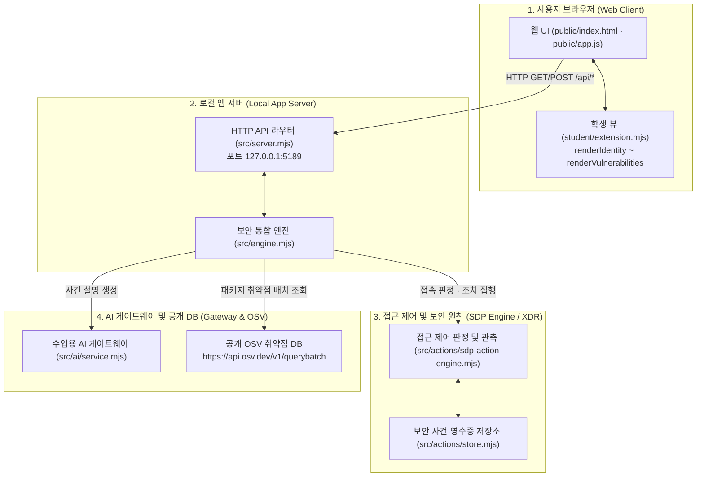

# 보안 Agent 「케셰브」 학생 실행 설명서 및 시스템 구성도 (STUDENT_RUNBOOK)

이 문서는 보안 Agent **「케셰브」** 프로젝트의 구조, 실행 방법, 시스템 구성도, 제공/학생 경계 및 장애 해결 절차를 기술한 공식 학생 실행 설명서(Runbook)입니다. 다른 작업자가 새로운 Windows PowerShell 환경에서 이 설명서만 보고 프로젝트를 실행하고 검증할 수 있도록 실제 검증된 명령어와 파일 경로만을 작성했습니다.

---

## 1. 실행 환경 및 사전 준비

### 1) 필요 프로그램 및 확인된 버전
* **운영체제**: Microsoft Windows (Windows 10 / 11 64-bit)
* **명령 셸**: Windows PowerShell (또는 PowerShell 7)
* **런타임**: **Node.js `24.19.0`** (권장, Node.js 20 이상 동작 가능)
  * 확인 명령: `node -v`
* **외부 의존성**: **없음**
  * `package.json`에 `private: true`로 선언되어 있으며 외부 npm 패키지를 설치하지 않습니다 (`npm install` 불필요). Node.js 내장 모듈(`node:http`, `node:fs`, `node:crypto`, `node:path` 등)만을 사용하여 구동됩니다.

### 2) Windows PowerShell 보안 정책 주의사항
* Windows의 기본 스크립트 실행 정책(`ExecutionPolicy`) 제한으로 인해 `npm` 입력 시 `npm.ps1 파일을 로드할 수 없습니다(PSSecurityException)` 오류가 발생할 수 있습니다.
* 따라서 PowerShell에서는 **`npm.cmd`** 배치 파일을 명시하거나, `node src/server.mjs` 명령어로 직접 실행하는 것을 기본 절차로 삼습니다.

---

## 2. 저장소 및 작업 폴더 구조

* **저장소 루트 (Git Repository Root)**:
  `c:\Users\je004\OneDrive\Desktop\Aleph\sec_pro`
* **프로젝트 루트 (명령어 실행 작업 폴더)**:
  `c:\Users\je004\OneDrive\Desktop\Aleph\sec_pro\on-client`

### 폴더 구조 요약
```text
c:\Users\je004\OneDrive\Desktop\Aleph\sec_pro\
├── .git/                                   # Git 저장소 메타데이터
└── on-client/                              # 실제 클라이언트 프로젝트 루트 (모든 작업 위치)
    ├── package.json                        # 실행 스크립트 정의 (start, demo, check)
    ├── .env.example                        # 환경 변수 예시 견본 (비밀값 없음)
    ├── .on-starter-manifest.json           # 제공 코드 원천 해시 목록
    ├── student/                            # [학생 작성 영역] 학생 구현 확장 모듈
    │   ├── extension.mjs                   # 13~20단계 UI 렌더링 함수 (renderIdentity ~ renderVulnerabilities)
    │   └── engine-adapter.mjs              # 엔진 어댑터
    ├── src/                                # [제공 영역] 로컬 백엔드 서버
    │   ├── server.mjs                      # HTTP 웹 서버 진입점 (포트 5189)
    │   ├── engine.mjs                      # 핵심 비즈니스 로직
    │   ├── actions/                        # 보안 조치(Action) 서비스 및 엔진
    │   ├── ai/                             # 수업용 AI 게이트웨이 연동 서비스
    │   ├── connection/                     # 계정/기기 연결 관리자
    │   └── vulnerabilities/                # OSV 패키지 취약점 대조 서비스
    ├── public/                             # [제공 영역] 브라우저 웹 클라이언트
    │   ├── index.html                      # 메인 화면 구조 (학생 슬롯 컨테이너 포함)
    │   ├── app.js                          # UI 상태 관리 및 student/extension.mjs 바인딩
    │   ├── style.css                       # 공통 스타일시트
    │   └── vulnerabilities-view.mjs        # 제공 패키지 조회 UI 모듈
    ├── docs/                               # 공식 안내 및 학생 문서
    │   ├── STUDENT_RUNBOOK.md              # [본 문서] 학생 실행 설명서
    │   ├── summary_md/                     # 단계별 요약 백업
    │   └── ...                             # 제공 과제 안내 문서들
    ├── summary_md/                         # 단계별 작업 요약 (STEP_13 ~ STEP_21)
    └── tools/                              # 실행 보조 스크립트 (start-alekov.ps1 등)
```

---

## 3. 설치 및 실행 절차 (`run_instructions`)

새로운 PowerShell 창을 열고 아래 순서대로 정확히 실행합니다.

### 1단계: 작업 폴더로 이동
반드시 `on-client` 폴더 안으로 이동해야 합니다.
```powershell
cd c:\Users\je004\OneDrive\Desktop\Aleph\sec_pro\on-client
```

### 2단계: 환경 및 구문 검사
Node.js 설치 및 학생 구현 파일의 문법 이상 유무를 사전 확인합니다.
```powershell
# Node 버전 확인
node -v

# 학생 구현 코드 문법 검사
node --check student/extension.mjs
```
*(아무 에러 출력 없이 프롬프트가 돌아오면 정상입니다.)*

### 3단계: 로컬 서버 실행
원하는 실행 모드에 따라 아래 명령어 중 하나를 입력합니다:

* **방법 A. 데모 모드로 실행 (화면 및 기능 검증 권장)**:
  예제 자료(모의 데이터)가 로드되어 모든 화면을 즉시 확인할 수 있습니다.
  ```powershell
  npm.cmd run demo
  ```
  *(또는 `node src/server.mjs --demo`)*

* **방법 B. 기본 모드로 실행**:
  ```powershell
  npm.cmd start
  ```
  *(또는 `node src/server.mjs`)*

### 4단계: 정상 시작 신호 확인 및 브라우저 접속
* **정상 시작 신호**:
  터미널에 다음 내용이 출력되면 서버가 정상적으로 시작된 것입니다:
  ```text
  http://127.0.0.1:5189
  ```
* **브라우저 접속**:
  웹 브라우저를 열고 아래 주소로 접속합니다:
  👉 **http://127.0.0.1:5189**

### 5단계: 종료 및 재실행 순서
* **종료**: 서버가 실행 중인 PowerShell 창에서 <kbd>Ctrl</kbd> + <kbd>C</kbd>를 누르면 즉시 안전하게 종료됩니다.
* **재실행**: 종료 후 동일한 창에서 다시 `npm.cmd run demo`를 입력하면 포트 충돌 없이 재실행됩니다.

---

## 4. 시스템 구성도 (`architecture`)

### 1) 시스템 구성 다이어그램 (Mermaid)



### 2) 4대 핵심 구성요소 상세 표

| 구성요소 (상자) | 실제 파일 경로 및 공개 주소 | 주요 역할 및 책임 | 보안 원칙 및 제약 사항 |
|---|---|---|---|
| **1. 사용자 브라우저<br/>(Web Client)** | • `public/index.html`<br/>• `public/app.js`<br/>• `student/extension.mjs`<br/>• 접속: `http://127.0.0.1:5189` | • 직원 화면 표시 (보호 현황, 업무 앱, 보안 기록)<br/>• 학생 구현 함수 바인딩 및 렌더링 | • 모든 DOM 주입은 `textContent`만 사용하여 XSS 방지<br/>• 학생 화면에서 실행(POST) 버튼 임의 미생성 |
| **2. 로컬 앱 서버<br/>(Local App Server)** | • `src/server.mjs`<br/>• `src/engine.mjs`<br/>• `http://127.0.0.1:5189/api/*` | • 계정, 기기, 세션, 앱 접속 판정 API 서빙<br/>• 요청 세대(generation) 및 타임아웃 관리 | • 이전 세대 응답 자동 폐기(`generation` 대조)<br/>• 비밀 설정값 클라이언트 노출 차단 |
| **3. 접근 제어 / XDR<br/>(Security Backend)** | • `src/actions/sdp-action-engine.mjs`<br/>• `src/actions/store.mjs`<br/>• `src/engine/sdp-host.mjs` | • 업무 앱 접속 인가 판정 (Allow / Deny)<br/>• 보안 조치(격리/차단) 집행 및 원천 효과 관측 | • **제안과 집행의 엄격한 분리**<br/>• 서버 접수(ACK)는 완료가 아니며, `effectApplied === true` 관측 시에만 성공 판정 |
| **4. AI 게이트웨이 & OSV<br/>(External Gateway)** | • `src/ai/service.mjs`<br/>• `src/vulnerabilities/project-scan.mjs`<br/>• 출처: `https://api.osv.dev/v1/querybatch` | • 보안 사건 근거 연결 AI 설명 생성<br/>• 프로젝트 `package-lock.json` 설치 버전과 OSV 취약점 DB 대조 | • 비밀 키·토큰 코드 및 문서 내 직접 기재 금지<br/>• 미조회/실패 상태를 "취약점 없음"으로 왜곡 금지 |

---

## 5. 제공 코드와 학생 작성 부분의 경계 (`provided_student_boundary`)

`.on-starter-manifest.json`을 기준으로 엄격하게 구분됩니다.

### 1) 학생 작성 부분 (`student/extension.mjs` 내 8대 구현 함수)
학생은 오직 `student/extension.mjs`의 `createStudentView` 객체 내부 함수만을 구현합니다:
1. **`renderIdentity` (13단계)**: 로그인 사용자, 기기 준수 상태(`compliant`, `noncompliant`), 활성 세션을 렌더링하며 세 자료의 모드(`mode`)를 각각 보존.
2. **`renderDecision` (14단계)**: 업무 앱 접속 판정 결과(`allow`, `deny`)와 평가 시각, 사유를 사용자 친화적인 한국어로 표시.
3. **`renderEvents` (15단계)**: XDR 탐지 보안 사건 목록과 근거(파일, 프로세스 등)를 구조화하여 나열.
4. **`renderStatus` (16단계)**: 시스템 통합 보안 경보 통지 목록과 문제 해결 진단 정보를 클립보드에 복사하는 기능 제공.
5. **`renderAiConnection` (17단계)**: 수업용 AI 게이트웨이 연결 상태(`connected`, `error` 등), 모델명, 지연 시간 표시 및 네트워크 오류 분기 처리.
6. **`renderExplanation` (18단계)**: 선택된 보안 사건의 근거에 기반한 AI 분석 설명, 수락 상태, 권한 상태 표시.
7. **`renderAction` (19단계)**: 11대 보안 조치 수명주기 상태(`idle`~`succeeded`)를 엄격히 분기하고, `effectApplied === true` 관측 시에만 효과 확인으로 렌더링.
8. **`renderVulnerabilities` (20단계)**: `package-lock.json` 설치 버전과 OSV 취약점 DB를 대조하고, 미조회/실패와 알려진 항목 없음(`none_found`)을 왜곡 없이 구분 표시.

### 2) 제공 코드 부분 (수정하지 않는 원천 영역)
* **서버 백엔드 (`src/`)**: `server.mjs`, `engine.mjs`, `actions/*`, `ai/*`, `connection/*`, `vulnerabilities/*`
* **기본 웹 클라이언트 (`public/`)**: `index.html`, `app.js`, `style.css`, `vulnerabilities-view.mjs`, `ai-connect.mjs`
* **환경 보조 도구 (`tools/`)**: `start-alekov.ps1`, `app-credentials.ps1`, `native-host-registry.ps1`, `prepare-native-host.ps1`
* **제공 문서 (`docs/`)**: `GETTING_STARTED_STUDENT.md`, `STUDENT_PROMPTS.md`, `CURRICULUM.json` 등

---

## 6. 실패 상황별 원인 및 확인 가이드 (`failure_guide`)

실제 화면에 표시되는 문구를 기준으로 작성된 문제 해결 가이드입니다.

| 화면에 표시되는 실제 문구 | 발생 원인 | 확인 및 복구 순서 |
|---|---|---|
| **`연결 실패: ...` / `연결 없음`** | 로컬 서버가 구동되지 않았거나 백엔드 연결이 끊어진 경우 | 1. PowerShell 창에서 서버가 켜져 있는지 확인<br/>2. `npm.cmd run demo`로 서버 정상 구동 확인<br/>3. 브라우저 새로고침(<kbd>F5</kbd>) |
| **`확인 불가 (unknown)`** | 데이터의 상태값이 비정상적이거나 신뢰할 수 없는 값인 경우 | 1. 서버 콘솔에 에러 로그가 찍혔는지 확인<br/>2. 모의 데이터의 형식이 스키마와 일치하는지 확인 |
| **`전체 조회 상태: 조회 준비 미완료 (not_configured)`** | 프로젝트 대상 경로 설정이 누락되었거나 프로젝트 연결 준비 중인 상태 | 1. 정상적인 초기 설정 대기 상태이므로 오류가 아님을 확인<br/>2. "미조회 상태는 취약점 없음이 아님"을 인지 |
| **`전체 조회 상태: 아직 조회 안 함 (not_checked)`** | 승인된 공개 패키지가 등록되지 않았거나 아직 조회를 실행하지 않음 | 1. 제공 영역의 `[설치 패키지 조회]` 버튼을 눌러 조회 트리거<br/>2. 담당자 허용 패키지 목록 존재 여부 확인 |
| **`전체 조회 상태: lock 파일 확인 불가 (unverifiable)`** | 프로젝트 루트에 `package-lock.json`이 없거나 잠금 파일 형식이 손상됨 | 1. 프로젝트 폴더 내 `package-lock.json` 존재 확인<br/>2. 잠금 파일의 버전이 2 또는 3인지 검증 |
| **`조회 실패: 패키지 조회를 취소했습니다...`** | 사용자가 `[패키지 조회 취소]`를 눌렀거나 타임아웃이 발생한 경우 | 1. 취소 시 이전 결과가 화면에 남지 않고 깨끗이 정리되었는지 확인<br/>2. 필요 시 `[설치 패키지 조회]` 버튼을 다시 눌러 새 요청 전송 |
| **`결과 불명 (unknown) · 효과 없음이나 성공으로 판단 금지`** | 조치 요청 후 서버 응답은 받았으나 원천 시스템의 실제 효과가 관측되지 않은 경우 | 1. 임의로 성공이나 실패로 단정하지 않음<br/>2. 제공 영역의 `[원천 결과만 재조회]` 버튼을 눌러 실제 적용 여부를 재확인 |

---

## 7. 실제 지원 범위 및 기다림(UNV) 목록

정직한 문서화를 위해, 현재 실제로 검증된 범위와 향후 외부 환경이 갖춰져야 하는 대기 항목을 엄격히 구분합니다.

### 1) 실제로 확인한 기능 (검증 완료)
* Windows PowerShell 환경에서 `npm.cmd run demo` 및 `npm.cmd start`를 통한 로컬 서버 정상 기동 (`http://127.0.0.1:5189`).
* `node --check student/extension.mjs` 문법 무결성 검증 100% 통과.
* 13~20단계 8개 학생 UI 컴포넌트의 모의 데이터 및 데모 렌더링 정상 동작 확인.
* 취약점 조회 취소, 타임아웃, 중복 응답 방지(`generation` 관리) 및 캐시 오염 차단 동작 확인.
* 모든 화면에서 XSS 취약점 차단(`textContent` 사용) 및 상태별 색상/텍스트 명문화 확인.

### 2) 기다림(UNV) 목록 (실제 확인 전으로 명시)
* **실제 외부 상용 SDP 및 XDR 서버 연동**: 현재는 로컬 모의 엔진 및 데모 모드에서 동작을 확인하였으며, 실제 기업 엔터프라이즈 방화벽/SDP 원천 게이트웨이와의 실시간 토큰 인증 및 격리 명령 집행은 외부 시스템 준비 대기 상태(`기다림(UNV)`)입니다.
* **실제 상용 LLM API 유료 키 연동**: 현재는 수업용 AI 게이트웨이 모의 규격으로 응답을 수신하며, 실제 외부 유료 AI API(OpenAI/Anthropic 등)에 대한 실시간 결제 기반 추론은 대기 상태(`기다림(UNV)`)입니다.
* **실제 OSV 라이브 대량 패키지 쿼리**: 로컬 `package-lock.json`의 승인 목록 기반 스캔 규격을 검증하였으며, 인터넷망이 완전 격리된 폐쇄망 환경에서의 실제 OSV 배치 조사는 인프라 설정 대기 상태(`기다림(UNV)`)입니다.

---

## 8. 실제 UI 경로 · 탭 · 버튼 이름 대조표 (Verification Matrix)

실제 화면 및 코드(`public/index.html`, `public/app.js`, `student/extension.mjs`)에 정의된 버튼 및 요소와의 100% 일치성을 대조한 표입니다.

| 화면 탭 (Tab) | 구역 (Section) | 실제 버튼 이름 및 화면 요소 | HTML id / 요소 속성 | 동작 및 확인 상태 |
|---|---|---|---|---|
| **보호 현황** | 설치 패키지와 취약점 정보 (제공) | **`[설치 패키지 조회]`** | `id="vulnerabilities-load"` | 패키지 취약점 대조 요청 전송 (**확인 완료**) |
| **보호 현황** | 설치 패키지와 취약점 정보 (제공) | **`[패키지 조회 취소]`** | `id="vulnerabilities-cancel"` | 조회 중 취소 및 이전 결과 제거 (**확인 완료**) |
| **보호 현황** | 학생 패키지 조회 표시 (학생) | 패키지 행 요소 | `data-student-package-name`<br/>`data-student-package-version` | 정확한 설치 버전 대조 및 속성 부여 (**확인 완료**) |
| **업무 앱** | 접속 요청 (제공) | 업무 앱 선택 버튼 (예: 회계, 메일) | `apps` 컨테이너 내부 버튼 | 서버에 접속 인가 판정 요청 (**확인 완료**) |
| **업무 앱** | 판정 결과 (학생) | 판정 상태 및 사유 텍스트 | `student-decision` | `allow` / `deny` 상태 한국어 표시 (**확인 완료**) |
| **보안 기록** | 최근 보안 사건 (제공) | 사건 행 선택 | `events` 컨테이너 내부 항목 | 보안 사건 선택 및 근거 로드 (**확인 완료**) |
| **보안 기록** | AI 사건 설명 (제공) | **`[AI 설명 요청]`** | `id="explanation-request"` | 선택 사건 근거 기반 AI 설명 생성 (**확인 완료**) |
| **보안 기록** | 원천 조치 (제공) | **`[조치 준비]`** | `id="action-prepare"` | 조치 제안 준비 (미실행 상태) (**확인 완료**) |
| **보안 기록** | 원천 조치 (제공) | **`[실행 승인]`** | `id="action-execute"` | 사람 확인 후 서버 전달 (**확인 완료**) |
| **보안 기록** | 원천 조치 (제공) | **`[원천 결과만 재조회]`** | `id="action-refresh"` | 결과 불명 시 재조회 트리거 (**확인 완료**) |
| **보안 기록** | 학생 조치 상태 (학생) | 조치 식별 속성 (버튼 미생성) | `data-student-action-event`<br/>`data-student-action-request` | `effectApplied === true` 관측 검증 (**확인 완료**) |
| **도움정보** | 통합 보안 상태 및 진단 (학생) | **`[진단 정보 복사]`** | `button` (`copyBtn`) | 진단 텍스트 클립보드 복사 (**확인 완료**) |

